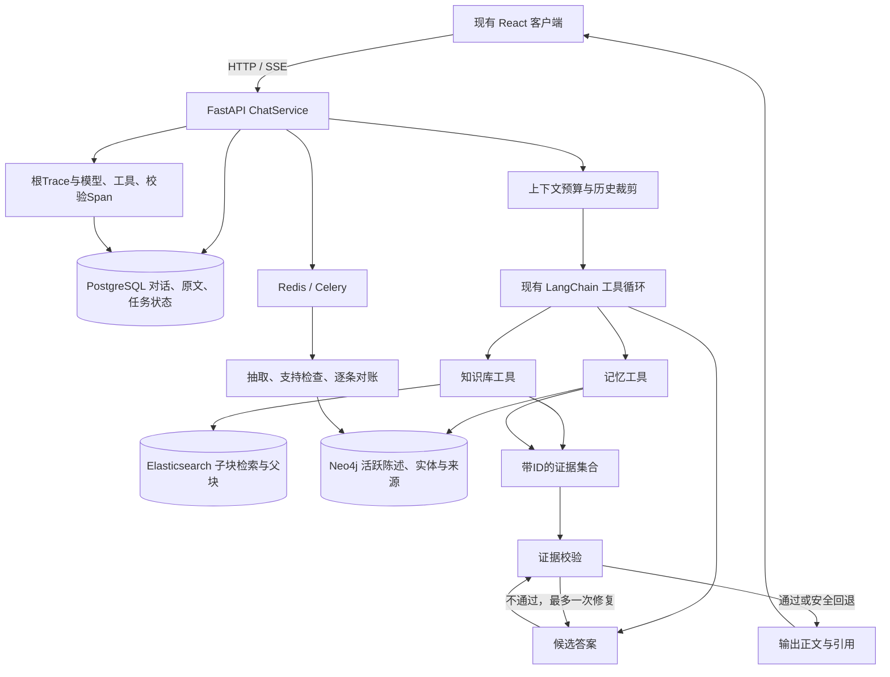

# 知忆 AI：记忆治理、可信回答与执行约束升级

实施：2026-10-25；复核：2026-10-26。准备目标：10 月 27 日新凯来面试。

本文解释本轮实际代码，不修改已投递简历，也不把小规模验证说成生产能力。原工作区已有改动，本轮在其上局部完善，没有重建项目或替换技术栈。测试数据均为合成数据，数据库验证使用独立容器，未迁移、清空或重建真实用户数据库与索引。

**先看“原流程和新流程对比”与文末“实际验证结果”，再按模块读。**原面经中“没有记忆容量、Token预算和事实校验”的表述是升级前的情况，以本文件和代码为准。

## 原流程和新流程对比：沿同一个例子走一遍

假设用户说：**“我研究 WiFi CSI，现在住北京，计划下个月去深圳。”**后来又说：**“我现在搬到深圳了。”**接着问：**“文档实验用了多少采样点？我研究什么？我之前去过深圳吗？”**

| 环节 | 升级前实际流程 | 升级后实际流程 |
|---|---|---|
| 保存原话 | 本轮问答正文写 PostgreSQL；成功答完后建异步记忆任务 | 原话及来源消息 ID 留在 PG；2026-10-27 增加每分钟扫描超 1 分钟的 pending 记录并重新派发，补齐初次 Celery 发布失败窗口；尚未恢复 worker 已领取后崩溃留下的 extracting 记录 |
| 拆解 | 对话模型抽陈述、实体、关系、事件；抽取出错有路径会退成空结果 | 模型尝试拆出“研究/居住事实”和“旅行计划”三条；解析错误标记任务失败；新增原话忠实性检查，但目前没有独立的原子性校验 |
| 去重和更新 | 主要做实体层的批内、历史融合；陈述没有完整版本状态 | 每条陈述先用向量和文本筛候选，模型判断动作；服务端核对候选 ID。UPDATE 另要求置信度至少 0.9、新句有明确变更词、记忆类别相同且不是历史事件。当前**没有**程序化校验“同一主体和属性”，所以“搬到深圳”能否准确替代“住北京”仍依赖候选和模型判断 |
| 容量 | 没有明确的活跃记忆与图节点预算 | 活跃陈述默认每用户最多 500 条，超出则归档低优先级陈述；整个用户图默认 10,000 节点预算，满时图事务失败并保留 PG 原话。数字是当前配置，不是实测出的行业阈值 |
| 再次提问 | 最近 40 条对话、预召回记忆和工具结果组装后交模型；五轮工具决策；结果直接流式输出 | 保留原循环，按估算 Token 预算裁剪旧历史与完整工具回合，限制工具次数和超时；模型仍自己决定用文档/记忆工具，两类工具都返回带来源 ID 的证据 |
| 生成答案 | 可引用检索结果，但没有在线事实与证据校验；空检索也可能生成肯定回答 | 先缓存候选答案；对需要证据的问题再发起一次证据支持检查，最多修复一次；只发布通过或安全回退的答案。“计划去深圳”不能证明“已经去过” |
| 可排查性 | 有局部工具日志，根 Trace 和子记录落库链路不完整 | 根 Trace 关联模型、工具、校验步骤；独立 PostgreSQL 验证了落库顺序；保存答案的校验状态和引用 ID |

现在面试讲一轮可以这样串起来：

> 用户原话先在 PostgreSQL 留来源，Celery 再让现有对话模型拆出独立陈述。“研究 CSI”和“住北京”是事实，“计划去深圳”是计划。每条新陈述先做来源核对，再从当前用户的活跃记忆筛候选；相似度只负责缩小比较范围，模型决定新增、重复、更新还是冲突，后端校验动作和旧记忆 ID。后来用户明确说搬到深圳，就把新居住事实设为活跃，把旧事实标为被替代，旧来源还在。用户再次提问时，模型可同时调用知识库与记忆工具；文档和记忆证据有各自 ID。服务端在发送最终正文前检查答案是否有据，错误就有限修复或拒答。整个循环还有次数、时间和上下文预算。

这不是“每轮都必定调用所有工具”：模型可以只问其中一种，也可以不调用；提问涉及个人或资料事实却没有证据时，当前服务端会尝试安全回退。**这里的“答完才提交记忆任务”表示问答请求与记忆处理异步，不表示新说的事实能立刻在同一轮被记忆工具检索到。**

### 面试官会继续追问的五句空泛说法

| 空泛说法 | 必须补出的真实实现与边界 |
|---|---|
| “RAG 有精排” | 有 `/rerank` 调用，但仅配置模型后执行；失败回退融合排序；0.99 的旧报告未测精排 |
| “模型负责去重合并” | 先核用户原话，再从本用户活跃陈述里以文本/向量相似度取最多 8 个候选；完整句可规则 NOOP，其余由模型选动作和至多 3 个旧 ID；后端核 ID，不存在结构化事实槽位硬校验 |
| “明确变化就更新旧记忆” | UPDATE 还需模型置信度≥0.9、变化词、新旧 `memory_kind` 一致、不得是历史事件；旧句标 `superseded` 保留来源。`dialog_at` 不是事实有效时间，仍会误更新 |
| “记忆有容量控制” | 默认最多 500 条活跃陈述，超出归档；10,000 图节点是另一层硬预算；PG 原文不自动删除，在线召回也不会读取所有活跃句 |
| “答案经过验证再流出” | 服务端先缓存候选答案，核证据 ID 与关键事实，最多修复一次后回退；检查依赖模型，不能保证绝无幻觉，且 SSE 首字延迟增加 |

## 先回答面试暴露的几个问题

### 一个用户到底存多少“消息”？

要区分三种东西：

| 内容 | 存在哪里 | 本轮策略 |
|---|---|---|
| 原始聊天与输入 | PostgreSQL messages / memories | 不自动删除，用于历史与溯源；尚未设置自动保留期限 |
| 可用于回答的原子记忆 | Neo4j Statement | 默认最多 500 条活跃记忆，可配置 |
| 整个用户图的节点 | Neo4j 的来源、分块、陈述、实体等 | 默认预算 10,000 个节点，达到预算拒绝新写入，不擅自删除历史 |

**500 是本项目的初始预算，不是行业标准，也不是500条聊天。**一句“我研究 CSI、住在北京、计划去深圳”可能产生三条记忆。图节点预算包括归档历史，不是只限制搜索结果；提交前在事务中检查，并为任务标记与可能的社区节点留出保守余量。原始 PostgreSQL 数据另需制定保留和存储监控策略，不能说系统所有存储都已有硬上限。

活跃记忆满了：代码按重要度×抽取置信度、`access_count`、创建时间排序，归档靠后的陈述。当前治理后的陈述召回路径尚未更新 `access_count`，所以不能说已根据实际访问频率动态归档。归档后默认不召回，但保留原文和来源。图的硬预算也满了：本次图事务回滚，原输入仍保留在 PostgreSQL，任务显示失败原因，需要确认保留策略后处理历史，不能靠继续归档无限腾空间。

### 怎么拆一句话，调用什么？

```text
用户输入原文 → PostgreSQL 保留来源
  → Celery 任务
  → 现有对话模型接口：抽取独立陈述及类型
  → 现有对话模型接口：抽实体、关系和事件
  → Embedding：为陈述和实体生成向量
  → 原文支持检查：这条陈述是不是原文真正表达的
  → 为每条新陈述找候选旧记忆，逐条决定动作
  → 一个 Neo4j 事务保存图、状态和对账结果
```

模型通过项目已有 `LLMClient.chat` 调 OpenAI 兼容的 `/chat/completions`，没有额外接入一个“记忆模型平台”。向量接口是 `/embeddings`。结果用 Pydantic 校验；模型输出截断、解析错误不再当成“没有记忆”成功处理。

每次输入最多处理 24 条陈述，避免一次长输入无限扩张成本；跳过数量记入 graph_stats，原文保留。这个限制还不是完整长文摘要方案。

### 去重、实体合并、事实更新，分别做什么？

| 操作 | 举例 | 当前实现 |
|---|---|---|
| 实体消歧 | “西电”是否指“西安电子科技大学” | 先限定相同实体类型；同名同类型仅“用户”或非空描述一致时直接复用，其他用名称相似/包含/向量筛候选，再让模型判 `same_entity` 且置信度至少 0.8 才复用实体 ID |
| 陈述去重 NOOP | “用户研究 CSI”重复出现 | 完整陈述与类型一致可规则判断，其余由模型比较；保留来源支持关系 |
| 新增 ADD | 研究 CSI，同时喜欢咖啡 | 两条独立记忆，不因为都提到用户就合并 |
| 更新 UPDATE | 原来住北京，明确说现在搬到深圳 | 新陈述成为活跃版本，旧陈述标 superseded，并连接 SUPERSEDES |
| 冲突 CONFLICT | 不能确认是替换还是同时成立 | 标 pending_confirmation，不默认作为事实召回 |
| 跳过 SKIP | 不值得保留的候选 | 保留处理原因，不进入活跃记忆 |

**向量相似只负责找候选，不负责证明应该合并。**服务端限制每条新陈述最多 8 个候选，模型只能返回候选中存在的 ID 和动作。UPDATE 还检查置信度、明确变更措辞和类型一致性；历史事件不自动覆盖。检查失败或模型超时就待确认，不破坏原记忆。

**实体融合与陈述融合分开执行。**“用户”实体复用或“西电”与“西安电子科技大学”被判成同一个 Entity，只意味着图上的对象节点相同；“用户就读西电”“用户去西电开会”仍是两条不同 Statement。实体候选没有进入筛选或模型误判时也会产生重复实体。关系图中同名实体复用，不代表把与它相关的所有事实合成一句。多信息输入先拆成原子陈述，一条一条与候选集合对账。

#### 实际对账规则：不要讲成“主体、关系、时间的精确匹配”

当前抽取器会同时产出陈述、实体、关系、事件，但**陈述对账只拿陈述文本、记忆类别、向量、置信度和对话时间**，没有先把图关系规范成 `(主体, 属性, 值, 有效时间)` 再做主键匹配。`Entity` 节点复用与 `Statement` 事实对账也是两件事。

1. 对当前用户最多读取 500 条活跃陈述。新陈述与旧陈述分别计算向量余弦和文本相似度，取两者较大值；保留分数不低于 0.25 的前 8 条。这个门槛宽松，只为减少模型要比较的数量。旧句没入候选，就可能被当作新增。
2. 原文支持检查再调用一次对话模型，只判新陈述是否由用户原话表达。它可能误判，也不验证用户所说在现实中是否真实。未通过时记为待确认。
3. 如果新旧**完整陈述文本归一化后相同，且记忆类别相同**，通常直接判 `NOOP`；历史事件和“今天、昨天、下个月”等相对时间表达不走这条快捷规则，避免把两次不同经历合并。
4. 其他候选交给对话模型，要求返回 `ADD / NOOP / UPDATE / CONFLICT / SKIP`、至多 3 个旧 ID 和 0～1 的置信度。后端验证 ID 确实在这次候选中；`NOOP` 置信度要达到 0.9。`UPDATE` 也要达到 0.9，且新句含“现在、不再、改为、更正、之前、已经、目前、搬到”等明确变化词；新旧 `memory_kind` 要相同，事件不能自动覆盖。不满足就改为 `CONFLICT`。**代码没有进一步校验这 1～3 条旧句确实属于同一主体、同一属性。**
5. `NOOP` 仍把新 Statement 和来源写进图，但状态是 `duplicate`，以 `SUPPORTS` 指向旧活跃句，旧句提及次数加一；正常召回只看活跃版本。`UPDATE` 新句活跃，旧句标 `superseded` 并连 `SUPERSEDES`；`CONFLICT` 标 `pending_confirmation`，不进入普通活跃召回。这里没有物理删掉来源。

**具体例子：**旧句“用户现在住北京”，新句“我现在搬到深圳”。合适的逻辑是主体和属性仍为“用户/现居城市”，值由北京变深圳。当前实现并没有显式的“现居城市”字段，只能先靠相似度把旧句找出来，再由模型给 `UPDATE` 和旧 ID；“现在搬到”满足后端的变更词规则。反过来，新句“我也喜欢咖啡”与“我研究 CSI”可同属用户，却是不同属性，模型应判 `ADD`。如果模型错误地把两条旧句都列为更新目标，当前后端虽限制最多 3 个合法候选 ID，**仍可能把两条都标成被替代**。这要当作现有风险回答。

**时间不能只看新旧消息的创建先后。**现在保存的 `dialog_at` 是用户说这句话的时间；它不是事实开始生效的时间。关系/事件抽取可能另带时间字段，但当前事实对账没有拿它们校验 UPDATE。比如“去年住北京，现在住深圳”应保留北京的历史版本与深圳的当前版本；两句同一天说出也可能分别指向过去和现在。可靠的升级方案是为原子事实补主体、属性、值、否定、`valid_from/valid_to` 与来源片段，同一主体和属性才比较值；明确更正时关闭旧版本的有效区间，历史经历不覆盖，不确定就待确认。**这套事实槽位和时间决策还只是规划，不能在面试中说成已实现。**

**一条输入涉及多件事：**“我住北京，研究 CSI，也喜欢咖啡”应先拆为三条独立陈述，每条各找候选；同批新活跃陈述也加入随后陈述的候选池，所以完全重复的拆分有机会被 `NOOP` 识别。如果模型把三件事错拆为一条，原文支持检查仍可能通过，因为复合句本身确实忠于原话；系统没有独立的原子性校验，可能造成一条记忆关联多个属性，或者后续漏匹配、重复新增。更成熟的方案需要检查“每条陈述只表达一个可单独更新的事实”，对复合句重新拆分，并用多事实、同义重复、时间更正和否定句的标注集测误合并与漏合并。当前不能保证图里永远没有重复信息。

### 两个任务同时更新怎么办？

先读用户记忆快照和版本号，在模型比较后进入 Neo4j 事务，获取该用户 MemoryLedger 的写锁，再核对版本。版本已变则回滚，Celery 最多重试两次，重新读快照对账。成功写入保存 MemoryIngestion 标记；同一个任务重复交付不会再写一份图。来源、分块和陈述 ID 根据用户与来源任务确定，方便追踪。

### 是否需要 MCP？

不需要为了记忆治理改成 MCP。当前是同一后端内的函数调用，已有工具注册与 LangChain 工具抽象。MCP 用于外部客户端发现和调用工具；它不会自动提供去重、冲突治理、容量策略或原文校验。

仓库已有 MCP 客户端接入代码；“接入了外部 MCP 工具”和“把自己的记忆服务发布成 MCP Server”是两件事。本轮未新增记忆 MCP Server。

## 当前架构与数据流



图中的修复循环由代码计数限制，不是无限回到候选生成。回答侧仍是一次问答内的执行流程，没有引入多 Agent 或 LangGraph 工作流。

## 模块一：长期记忆治理

**状态：核心逻辑已实现；验证范围见下方结果文件，不能据此声称大规模线上可用。**

1. **改造前的问题**：主要在实体层去重，缺少事实级更新状态；同名同类型可能误合并；陈述展示统一叫“事实”；没有活跃容量与图预算；抽取失败可能返回空列表。
2. **完整流程**：抽陈述 → 类型区分 → 向量化 → 原文支持检查 → 候选筛选 → 动作判断 → ID/置信度/变更约束 → 锁与版本核对 → 单事务落图 → 活跃超额归档。计划默认30天、预测默认7天，到期不召回；事实与历史事件仍受容量排序约束。
3. **为什么这样选**：复用 Statement、Dialogue 和现有模型接口，保留来源，避免重建记忆库。没有将“低相似度”直接当新增事实，也没有直接让模型执行数据库删除。
4. **关键数据与代码**：`core/memory/governance/policy.py` 中 MemoryDecision、validate_sources、decide；`service.py` 中 prepare_policy、apply_policy；仓储 save_graph 使用用户锁、版本、任务标记与硬容量检查；陈述增加 status、memory_kind、expires_at 等属性。**原子性只覆盖一次 Neo4j 图提交，不覆盖 PostgreSQL 与 Neo4j 的分布式事务。**
5. **测试**：独立 Neo4j 的结果见 [memory-graph-results.json](memory-graph-results.json)；真实模型到图写入与召回见 [live-memory-results.json](live-memory-results.json)，文件存在且通过才算该路径验证通过；离线判断与边界用例在 `tests/test_upgrade_policies.py`。
6. **局限**：没有自动合成可证明无损的压缩摘要；归档不是删除；旧记忆没有自动批量补向量或语义重标；候选筛选和模型判断都可能漏判。相对日期及同名人物仍需更大评测集。原文支持校验验证的是忠于用户说法，不证明用户说法在现实世界里是真的。
7. **面试追问**：
   - “超过500怎么办？”——归档低优先级活跃陈述；图总预算再阻止继续写入，原文保留。
   - “为什么不按消息数？”——一条输入有多项事实，检索与更新单位是原子陈述。
   - “模型怎么合并？”——模型给动作和候选ID，服务端校验，再执行版本化更新；不允许模型直接写 Cypher。
   - “同时涉及多条记忆？”——先拆分，再逐条比较候选；互补事实可以共存。
   - “怎么处理不确定冲突？”——待确认，用户通过明确接口保留、替换或拒绝。

### 实际新增的查看与确认接口

- `GET /api/memories/policy/status`：当前用户状态统计、容量配置、最近50条待确认陈述。
- `POST /api/memories/statements/{id}/resolve`：`{"action":"keep_both"}` / `replace` / `reject`。验证当前用户归属，仅处理待确认陈述。

它们是补充接口，原上传、聊天和记忆接口保留。当前前端未新增冲突审核面板，可通过接口检查。

## 模块二：RAG证据与可信回答

**状态：代码已实现；数据库、模型和SSE边界分别验证，不把分段测试说成整站端到端测试。**

### Rerank 的准确口径

项目**已经实现** rerank 调用和失败回退，不能说“以后再加 rerank”。普通知识库检索先在 Elasticsearch 各取最多 20 个向量/BM25 子块，按子块 ID 合并、分别归一化，再用向量 0.6 + BM25 0.4 排序。若当前用户配置了 rerank 模型，就把前 20 个候选子块正文连同问题送到 `/rerank`，取精排前 5 个；最后按 `parent_id` 回取父块作为证据。**没有配置 rerank 模型，或请求失败时，直接采用融合排序。**`min_vector_score` 全局搜索分支会提前返回，也不走 rerank。最终结果上的 `score` 仍是融合分，不能把它解释为 rerank 分。

原 10 篇文档/22 题的 nDCG@5≈0.99 **没有配置 rerank 模型**，只反映当时混合检索基线；没有升级前后精排增益数字。面试可说“精排能力已接入，可配置运行；这份离线成绩没有验证精排收益”，不能说“已用 rerank 达到 0.99”。

1. **改造前的问题**：工具给模型一段纯文本，引用只是检索到的文档列表；未建立答案与证据的检查。空检索后服务端仍可接受模型编出的正文。所谓 Verifier 仅有离线 HotpotQA 判分函数，在线没有验证闭环。
2. **完整流程**：混合召回 → 保留原始相关性信号 → 过滤明显无关内容 → 给每段证据分配ID并保留来源、分块ID和内容 → 生成候选答案 → 校验关键事实与已知证据ID → 不通过最多修复一次并再校验 → 仍不通过或服务失败则安全回退 → 只发送最终正文与使用过的引用。
3. **为何选此方案**：现有离线 QA judge 的“问题、答案、证据独立校验”适合提取成在线能力。现有在线 Verifier 实现并不存在，因此新增 `verification.py` 承接这个模式，而非并行运行两套在线校验。没有把引用ID存在当成事实正确的充分条件。
4. **代码与异常**：`tools/builtin/knowledge.py`、`memory.py` 构造证据；`verification.py` 中 Verdict 与 verify_answer；`ChatService` 缓存候选，不把未验证正文提前发出。未知引用、空证据、校验JSON错误、超时和修复失败都有回退。向量故障可降级 BM25；系统不伪造检索内容。
5. **测试**：实际 ES 隔离验证见 [rag-results.json](rag-results.json)；真实模型样例见 [live-model-results.json](live-model-results.json)；单元测试验证候选中的错误标记不会进入 SSE 或最终保存正文。
6. **局限**：LLM judge 不是事实证明，存在漏判；默认可回退到同一个聊天模型，不一定是独立模型。当前“需要证据”判断使用工具调用和简单问题规则，未覆盖所有问法。相关性阈值需校准。正文验证后分块发出，保留 SSE 协议但增加首字等待，不是模型边生成边立即显示。
7. **面试追问**：
   - “引用准确率等于检索召回率吗？”——不是，召回是找没找到，引用检查还要看答案是否被那段证据支持。
   - “工具失败还能回答吗？”——闲聊可以；资料事实问题缺证据时回退，不能凭模型编结果。
   - “为什么先缓存答案？”——未经校验就流给用户，失败后难以撤回；这里用首字延迟换可靠性。
   - “能完全消除幻觉吗？”——不能，只能增加约束与可测的防线。

### 修复的 ES 查询问题

原向量路径同时写顶层 filter-only query 与 knn，两者在 ES 中是 OR 合并，不是额外过滤。现在把用户与知识库过滤留在 knn 内，避免把过滤范围内的普通文档混入向量候选。线上检索和离线评测客户端一起修正。旧报告保留，不覆盖。

## 模块三：Agent Runtime / Harness

1. **改造前的问题**：有多轮循环，但五轮并不等于五次工具调用；工具缺统一执行超时，普通调用没有上下文预算，重复调用只缓存不主动止损；Trace未接根入口和落库生命周期。
2. **完整流程**：用户与会话范围由服务端确定 → 构建现有结构化工具 → 组装上下文并估算预算 → 模型决定工具 → 校验参数并受限执行 → 结果回灌 → 到达条件或预算退出 → 最终生成与验证 → 保存正文与追踪。
3. **取舍**：保留现有 LangChain 消息、StructuredTool、Schema 与模型适配。执行边界在两个已有循环共享，不为两个核心工具迁移整个框架。没有假装自写循环比成熟框架更强，只是当前局部改造成本更低。
4. **关键实现**：`agent/runtime.py` 中 ExecutionState、fit_context、execute_tool；原 `orchestrator.py` 继续执行。默认最多5轮决策，之后最多一次无工具收尾；每次问答最多8个工具调用；普通工具20秒，单次模型60秒，整轮180秒；只对已知只读工具的连接/超时失败有限重试。外部工具不默认重试写操作。输入预算约12000 tokens，输出每次1024，计入工具Schema；裁剪完整旧对话/工具组，不拆坏工具协议。
5. **测试**：原循环测试保留；新增历史裁剪、当前输入过大、工具超时、参数错误不重试和外部写工具不重试。真实模型样例已验证一个问题调用知识库与记忆两个工具。
6. **局限**：Token计数是统一编码器估算，不等于供应商精确计费；没有全局费用硬限额、持久化执行检查点或断点恢复。历史当前是裁剪，不是自动摘要。ReAct 文本降级的稳定性仍弱于原生 Function Calling。
7. **面试追问**：“五轮是什么？”——工具决策轮数；“如何停止？”——模型不再调用工具、达到轮数/调用预算、重复请求止损或超时；“为什么不加LangGraph？”——当前先验证执行约束，暂不需要它提供的持久化复杂状态图。

### Trace修复

根 trace 在 ChatService 建立；应用启动/关闭管理 SpanRecorder；模型和工具已有 span 能挂到根执行上。真实 PostgreSQL 测试发现原批量写入存在子记录先写导致的外键错误，已显式先 flush 主记录再写 span。错误与取消状态不能统一记成功。结果见 [tracing-results.json](tracing-results.json)。

异步 ES、Neo4j、Redis 客户端改为按事件循环复用；任务退出只关闭本循环资源，避免 Celery 线程中的一个任务关闭其他任务的连接。实际线程池长期稳定性还需要负载测试。

## 模块四：测试、评测与对比

1. **改造前的问题**：只有17项隔离测试和小规模检索报告，不能说明答案可信、记忆更新正确或完整Agent成功。
2. **流程**：保留历史报告与哈希 → 确定具体失败场景 → 单元回归 → 独立数据库真实事务验证 → 真实模型合成输入验证 → 固定语料重新检索 → 保存逐题输出与验证范围。
3. **取舍**：优先验证会问到的具体行为，不以增加工具或多Agent数量作为升级成果。真实模型样例不是大规模准确率评估。
4. **数据和代码**：`tests/test_upgrade_policies.py`，本目录 verify_*.py；固定检索集仍是 `api/eval/fixtures` 的10篇文档/22题。历史基线保存在 `docs/audit-artifacts-20261016/baseline.json`，包含当时排名、依赖与哈希。
5. **实际结果**：以本目录 JSON 与文末汇总为准；`live-model-first-evaluator-results.json` 保留了初次评价器把否定表达中的“已经去过”误当正面断言的记录，修正评价规则后重跑，不删除失败历史。历史 nDCG@5=0.9944 不改写成本次结果。
6. **局限**：尚无大样本有据率、引用准确率、正确拒答率、全任务完成率及稳定成本统计；没有全栈浏览器+Celery+真实存储长时压测。新增边界测试通过不能转述为这些指标已达标。
7. **面试追问**：先报样本规模与真实调用范围，再报结果；分清“模拟工具测试”“真实数据库事务”“真实模型小样例”“固定检索集评测”，不把它们混成一次完整生产压测。

## 兼容性与迁移

- FastAPI 现有请求路径、SSE 的 meta/tool_start/tool_result/token/citation/done/error 事件保留，新增字段是可选信息；前端构建另行验证。
- PostgreSQL 没有新增表或删除字段，复用 messages.meta_data 与现有 Trace 表。
- Neo4j 新增 Statement 属性和 MemoryLedger、MemoryIngestion 标签及唯一约束，不重建旧图。真实环境启动前应备份，并确认新增约束可创建；本轮只在独立测试库验证。
- 旧陈述缺少 status 时按 legacy/active 兼容。旧图不会自动全量补标或补向量，已有数据需要后续显式迁移计划。
- 关闭治理开关不会自动恢复已归档或已被替代的状态；需要按审计记录恢复，不能承诺一键回退数据。
- 禁止默认自动重建 ES 索引；检测到不兼容 mapping 时报告，由显式迁移处理。

## 原方案仍需继续处理的事情

- 原记忆删除接口主要删除 PostgreSQL 来源记录，未完成图数据撤回的完整闭环；不能把它描述为全存储硬删除。
- 2026-10-27 已用 pending 记忆扫描补齐初次队列发布失败窗口；仍无完整任务 Outbox、`extracting` 崩溃回收与文档任务补发。
- 历史反思/巩固代码存在未完整接入的任务入口，不能说后台摘要和容量压缩已全部完成。
- 跨会话的指代、严格时间槽位理解、同名人物与恶意记忆注入，需要更多针对性数据与人工复核。
- 容量阈值、召回阈值是初始配置，尚未通过大量用户负载得出容量结论。

## 工业实践参考：借鉴什么，不照搬什么

- [Mem0 的更新操作](https://docs.mem0.ai/core-concepts/memory-operations/update)：先定位记忆 ID，再提交更新；不是相似就直接覆盖。
- [Mem0 的遗忘与操作设计](https://mem0.ai/library/agent-memory/memory-eviction-and-forgetting-in-ai-agents)：抽取后选择新增、更新、删除或无操作。本项目改用保留版本与待确认，避免自动删除原记录。
- [Letta Memory Blocks](https://docs.letta.com/v1-sdk/memory/memory-blocks)：上下文常驻记忆有预算；不意味着所有历史必须塞进提示词。本项目区分原始来源、活跃记忆和单轮上下文。
- [LangChain 工具](https://docs.langchain.com/oss/python/langchain/tools)：复用工具Schema与执行抽象。
- [Elasticsearch kNN 查询](https://www.elastic.co/guide/en/elasticsearch/reference/8.17/knn-search.html)：顶层query与knn为OR组合，过滤放在正确位置。

## 面试总介绍：约一分钟

> 我这次主要补了记忆治理和问答执行的可靠性。记忆以原子陈述为单位，保留原文来源；新输入先拆解和验证，再找候选旧记忆，分别判断新增、重复、更新或冲突。更新保留历史版本，冲突待确认；同时设置活跃记忆预算和图存储预算，避免无限增长。
>
> 问答侧保留现有LangChain工具循环，增加调用次数、超时和上下文预算。RAG与记忆工具返回带ID的证据，答案先校验，失败有限修复或回退，再通过SSE输出。我分别用隔离测试、独立数据库和真实模型小样例验证，哪些还没有生产或全链路验证会明确说明。

## 实际验证结果：面试时按层次说

| 范围 | 结果 | 能证明什么、不能证明什么 |
|---|---|---|
| Python 自动化回归 | 10 月 26 日 **44 项通过**；10 月 27 日增加记忆补发/去重/冲突、Trace 隐私和生产密钥启动测试后 **50 项通过** | 覆盖核心规则、预算、超时、拒答、SSE 候选答案隔离与部分任务故障；没有证明线上准确率 |
| 隔离 Neo4j | **14 项行为检查通过**，含新增、重复来源、事实替代、冲突待确认、容量归档、图硬限额、并发版本冲突、跨用户隔离，以及用户确认“替换/并存” | 真实事务和查询已跑通；不是原用户库迁移测试。[逐项结果](memory-graph-results.json) |
| 真实模型的小样例 | **6/6 通过**：多信息拆解、明确更正、并存偏好、有据数值回答、计划不当作已完成、同一问答调用 RAG 与记忆 | 只说明这些合成样例当前模型可处理；样本太少，不能报“正确率100%”。[逐项结果](live-model-results.json) |
| 真实模型 + 向量 + 隔离 Neo4j | “研究 WiFi CSI；计划下个月去深圳”抽出 **2 条**，写入后按类型召回；重复交付同一任务未增加 Statement | 证明这条合成输入的抽取、准入、写图、召回闭环；后台反思与聚类在此脚本中隔离，未覆盖完整 Celery/浏览器流程。[结果](live-memory-results.json) |
| 隔离 ES | 用户范围隔离、低相关证据不进入工具输出、空结果不伪造、向量故障降级 BM25 均通过 | 验证检索路径的几个关键边界。[结果](rag-results.json) |
| 固定 10 篇文档 / 22 题 | 混合检索 Recall@5 **1.00**、MRR **1.00**、nDCG@5 **0.9944**；向量 nDCG@5 **0.9861** | 本次指标与保留的历史报告数值相同；不能据此宣称检索质量提升，且模型部署时间条件未严格控制。[逐题报告](retrieval-results.json) |
| 隔离 PostgreSQL Trace | 根记录和 2 条子 Span 正常落库；模拟 Token 用量 100/20 | 验证关联和写入顺序。模拟用量不代表实际调用账单。[结果](tracing-results.json) |
| React 前端 | `npm run build` 通过 | 证明类型和打包可用；没有完成浏览器全链路验收。构建有已有的大包体积提醒 |

真实模型测试第一次用简单字符串匹配判断“已经去过”，把“**无法确认已经去过**”误判为错误。保留了[第一次评判记录](live-model-first-evaluator-results.json)，修正断言后重新运行 6 项。这个例子说明离线评测也会误判，不能只看总分。

**已实现并验证**：上表各自覆盖的范围。**已实现但未验证到全栈**：现有浏览器 → FastAPI → Celery → 所有数据库 → SSE 的持续端到端场景、新冲突确认接口的真实浏览器操作、长时多用户负载。**仅规划**：可回溯的自动摘要压缩、PG 与任务队列的可靠 Outbox、旧数据批量重标、图数据完整撤回和大样本答案引用准确率评测。

自己先跑最短的回归检查：

```bash
cd /home/xiaobin/myproject/zhiyi-rag-memory-agent
api/.venv/bin/python -m pytest api/tests -q -p no:cacheprovider
cd web
npm run build
```

数据库与真实模型脚本在 `docs/upgrade-20261025/verify_*.py`；它们要求显式传入**一次性测试容器的随机本地端口**，并使用合成用户。不要把运行结果误写成线上生产表现。

关键入口便于对着代码讲：[记忆抽取](../../api/app/core/memory/extraction/orchestrator.py)、[对账决策](../../api/app/core/memory/governance/policy.py)、[记忆预算与入图](../../api/app/core/memory/governance/service.py)、[Neo4j 事务](../../api/app/repositories/neo4j/memory_graph_repository.py)、[Agent 执行约束](../../api/app/core/agent/runtime.py)、[答案证据校验](../../api/app/core/agent/verification.py)、[SSE 问答](../../api/app/services/chat_service.py)。

## 2026-10-26 面试官复审：目前距离成熟应用还差什么

**当前定位：功能闭环较完整的个人 AI 应用原型。**记忆、RAG 和工具循环都有真实实现；长期记忆正确性、工具信任边界及全链路评测还不足以称为成熟系统。下面的判断来自代码和本地探针，不能把改进建议说成已经落地。

### “核对原话”实际上怎样做

`statement_extractor.py` 先调用对话模型生成原子陈述。`governance/policy.py` 的 `validate_sources` 随后把**同一段原话与这些陈述**再次交给对话模型，让它返回 `supported_ids`。服务端用 Pydantic 校验 JSON，并检查返回的 ID 是否在本批候选中；失败的陈述标为待确认。它检查的是“抽出的陈述是否忠于用户说法”，不能验证说法在现实中是否真实。

这不是独立的算法证明：抽取和核对默认使用同一个 `chat_client`，可能犯相同错误；JSON Schema 只限制输出形状，不能保证语义判断正确。要增强它，优先让每条记忆带原文片段位置、说话主体、否定、模态词和明确时间；服务端检查片段确实来自原文，再用语义判断处理改写。模型判定仍需用人工标注的正例、反例和冲突例评测。

### 具体薄弱点与优先级

| 优先级 | 代码中的现状 | 面试官会追问什么 | 建议的最小闭环 |
|---|---|---|---|
| P0 记忆准入 | 没有旧候选时 `decide` 直接 `ADD` 并给决策置信度 1，未检查抽取置信度或长期价值。本地探针中置信度 0.1 的“今天随手吃了面”仍返回 `ADD` | “是不是聊天每句话都越积越多？” | 先判断是否值得长期保存；明确的身份、稳定偏好、正在进行的项目等可入库，闲聊与一次性问题跳过。保存来源和跳过原因；用带标签样例测误收与漏收 |
| P0 事实合并 | 向量余弦或文本相似度只筛最多 8 个候选；同一模型给 `ADD/NOOP/UPDATE/CONFLICT`。没有稳定的“主体—属性—值—有效时间”槽位；`UPDATE` 还靠“现在、改为”等词做硬判断 | “住北京、搬深圳、去深圳旅游会不会误合并？” | 加主体、关系/属性、值、否定、计划/事实、有效时间等结构化字段；先按用户与槽位找候选，再让模型比较语义；更正要指向旧 ID，保留版本，矛盾时待确认 |
| P0 答案证据门控 | `ChatService` 靠工具是否被调用或问题关键词决定是否校验。若模型未调用工具，“科研方向是什么？”不命中当前关键词规则，可能直接输出未校验正文 | “模型忘记检索还会被拦住吗？” | 服务端明确识别资料/个人记忆问答并设 `evidence_required`；缺证据先强制读工具或安全回退，不能仅依赖模型自觉与关键词 |
| P0 工具结果边界 | 内置工具有 Pydantic `query` 长度约束、执行超时和次数上限；但错误分类部分靠字符串前缀。探针中外部工具返回 `ERROR: upstream failed` 被标为 `success`；工具正文没有统一的每次输出上限或风险等级 | “模型收到报错、恶意文档或超长结果会怎样？” | 工具统一返回 `{status,data,error,source}`，按状态而非文本判断；统一截断/摘要工具输出并计入预算；外部写工具单独授权与审核，检索文本只当数据 |
| P1 图谱价值 | 活跃陈述向量检索命中后，`search_memory` 直接返回陈述；通常不再走原有实体关系与一跳邻居路径 | “用了 Neo4j，实际问答为什么不是图查询？” | 做实体/关系问题的路由：事实问句可直查陈述，多实体关系或时间路径问题走图遍历，并同时返回支撑陈述；用对照题证明图检索的增益 |
| P1 上下文 | 现有预算是 `cl100k_base` 估算并裁剪旧回合；单个当前问题或工具结果很大时仍可能超额或丢掉刚得到的工具上下文；没有可回溯摘要 | “长对话里旧约束被裁掉怎么办？” | 为系统规则、最近对话、记忆与每次工具结果分别分配预算；超限先压缩工具结果，再对旧历史做附带原文引用的摘要；验证裁剪后关键事实仍能回答 |
| P1 记忆召回与容量 | 活跃陈述在 Neo4j 内逐条算余弦并排序，默认上限 500；归档不删旧节点，图总预算到达后停止写入。旧评测中记忆 Recall@5 约 0.61，升级后尚未重测该集 | “500 怎么定的？图满了怎么办？召回有没有变好？” | 在真实失误样例上评测新路径；监控活跃数、归档率、图总量与失败率。决定经过审核的归档/导出/删除策略后再扩大容量，不能把 500 说成压测结论 |
| P1 评测与运维 | 原回归和小样本评测不足以判断真实效果；2026-10-27 已加 pending 记忆补发与领取去重，但没有恢复 extracting 崩溃任务，也未覆盖文档解析任务 | “这次升级是否真的提升效果？” | 为抽取、去重、工具选择、参数、答案引用、拒答建同一批标注用例；保存逐题轨迹与错误分类，对比升级前后，再补任务租约与文档解析补发 |

前三个本地探针仅验证**代码允许这些行为**：低置信度无候选走 `ADD`；外部工具错误字符串被标成功；给定“科研方向是什么？”时当前门控正则返回假。它们不代表真实模型在每次请求中都一定犯错。

### 面试时应如何回答“你们的记忆去重是不是太简单”

> 你说得对。现在已经不是按实体名称完全一致就把事实合并：输入会先拆成原子陈述，核对原话，再用文本和向量找候选，模型选择新增、重复、更新或冲突，服务端检查旧 ID、更新条件和用户范围；旧版本也保留。但这仍是候选检索加模型判断，没有稳定的事实槽位和足够大的人工标注集。当前最大的误判风险是没找到旧候选就新增、模型抽取和核对同源，以及时间与否定表达。我会先补“主体—属性—值—有效时间”与原文片段，再用互补事实、明确更正、同名不同人、否定和计划/完成的对照集测误合并率与漏合并率。

LangChain 官方将[工具错误、调用次数、摘要和人工确认](https://docs.langchain.com/oss/python/langchain/middleware/built-in)分别作为执行组件；本项目已覆盖其中部分约束，其余需要围绕现有场景补齐。[Mem0 的记忆添加说明](https://docs.mem0.ai/core-concepts/memory-operations/add)也明确区分从对话抽取与存储原文。外部检索内容可能包含指令，[OWASP 的提示注入说明](https://genai.owasp.org/llmrisk/llm01-prompt-injection/)提醒要按不可信输入处理；只在 prompt 写“不要执行”不足以代替权限和输出检查。

## 2026-10-27：参考 GitHub 实现后的架构升级路线

这里参考的是机制和边界，不把别人的项目改个名字，也不把本项目称为生产级。Comet 现有 `loop_model.py` 确实有报告任务的状态与迭代记录；问题在于知忆当前**在线问答**并没有持久化的逐步执行状态，也缺乏足够的失败恢复、可复现评测和模块契约。网站功能多少不能证明 Agent 的质量。

### 看过什么代码，借什么，不借什么

| GitHub 代码 | 可以学的机制 | 知忆需要的对应改造 |
|---|---|---|
| [LangGraph checkpoint 状态定义](https://github.com/langchain-ai/langgraph/blob/main/libs/checkpoint/langgraph/checkpoint/base/__init__.py) | checkpoint 有版本、执行步、运行 ID、通道状态；中断后可知已完成到哪步 | 给一次问答明确 `run_id/step/status/tool_result_ref`，只对耗时或有副作用的任务持久化检查点。当前五轮读工具不用为了“用了 LangGraph”而整体替换 |
| [Dify workflow 运行边界](https://github.com/langgenius/dify/blob/main/api/core/workflow/node_runtime.py) | 模型、工具、文件访问和运行上下文是不同的协议/适配层 | 把工具返回标准化为 `ok/empty/retryable_error/permanent_error`，工具权限与输入输出限制统一由后端执行；避免新增工具时复制一套异常判断 |
| [Langfuse 带鉴权 API 包装](https://github.com/langfuse/langfuse/blob/main/web/src/features/public-api/server/createAuthedProjectAPIRoute.ts) | 路由显式声明 action、请求/响应 Schema、限流和错误契约 | 知忆工具注册也声明用户范围、风险级别、超时、响应上限；每个工具都过同一个执行器，不能让模型给 `user_id` 或跨用户文档 ID 决定读取范围 |
| [Mem0 用户范围过滤](https://github.com/mem0ai/mem0/blob/main/mem0/memory/main.py) | 身份范围由调用参数确定，任意 metadata 不能覆盖身份字段 | PG、ES、Neo4j 查询的 user_id 都取登录上下文；增加跨用户读/删/重试和元数据伪造的契约测试 |

### 本轮已落地的最小垂直改造

1. **记忆任务补发**：`ChatService._dispatch_memory` 与 `MemoryService.remember` 先提交 PG `memories` 原文，仍尝试立即发 Celery。新增 `tasks/memory.py` 的每分钟扫描：只找创建超过 1 分钟且仍是 `pending` 的最多 100 条，再发到 `memory` 队列；Compose 新增独立 beat 服务。Celery broker 短暂不可用后恢复时，已提交的原文仍有机会被处理。
2. **重复任务领取**：记忆 worker 先执行条件更新 `pending → extracting`，只允许影响 1 行的任务继续调用模型、写图；补发与初次投递同时到达时不会双份抽取。同一用户两条不同任务争图谱 revision 时，未耗尽重试可恢复 pending 后重试；耗尽则写 `failed`，不会无限重试。当前没有 `extracting` 租约续期或超时回收，worker 在领取后崩溃仍可能留下卡住的记录，这是下一步。
3. **入口和错误边界**：上传入口最多读取 50 MiB + 1 字节便拒绝超大文件，避免一开始无上限 `read()`；SSE 不再把模型初始化或执行的原始异常原文返回浏览器。Trace 默认只保留用量、状态、耗时等运维字段，不落问题、答案或工具输出预览，只有显式打开 `trace_capture_content` 才记录这些内容；`mark_error` 默认也只写通用错误标记。生产模式若仍使用示例 JWT/Fernet 密钥则在应用启动时拒绝服务。服务端日志仍保留排查信息，还需给反向代理设置请求体上限并审计日志脱敏。

这些改动解决的是确定的故障窗口，不代表任务已达到“PG 与 Redis 原子提交”。后续更完整的任务 Outbox 需要 PG 原文和事件同事务提交、独立派发器、领取租约、版本栅栏、重试和死信；不能只给 Celery `.delay()` 加 `try/except` 就宣称可靠。

### 真正能让这个 AI 项目从演示走向可维护应用的四段升级

**A. 可信问答（下一段先做）**。以 `chat_service.py` 的“是否需要证据”关键词判断为切入点：创建服务端 `AnswerPolicy`，把问题分为一般闲聊、用户记忆、文档事实和混合题；需要证据而模型没调用相应工具时，由后端主动补检索，再只用授权的证据生成答案。证据保存 `user_id/source_id/chunk_id/span/版本`；Verifier 对每个关键断言标注支持、矛盾或未知。失败允许一次修复，再拒答。验收集必须有“我的研究方向是什么”“计划去深圳是否等于去过深圳”“文档不存在答案”“恶意文档写了忽略规则”等题，统计有据率、误拒率、引用 ID 正确率和首字延迟。仅靠再加一个模型打分仍不够。

**B. 工具与运行时契约**。现有 `orchestrator.py` 有循环和时间预算，但工具失败状态部分靠字符串，且在线回答没有持久化 step。建立单一 `ToolResult` 类型和注册表：`name/schema/scopes/timeout/max_output_bytes/retry_policy/side_effect`；后端注入用户身份，调用前校验参数，调用后限制输出，区分空结果与故障。对外部写操作引入幂等键和人工确认；当前两项内置读工具先不引入 MCP。持久化运行快照只在要跨进程恢复的长任务上做，避免为普通短对话付出状态管理开销。验收：工具超时、结果超长、非法参数、重复调用、进程重启各有可复现轨迹和确定的终止状态。

**C. 记忆生命周期**。当前 `Statement` 的 UPDATE 依赖候选相似度、模型和“现在”等词，没有可靠的事实槽位。按一条原话拆多条陈述，每条必须留原文 span，并显式保存 `subject_id/predicate/value/modality/valid_from/valid_to/source_id`；先限定同用户、同主体、同属性的候选，再让模型判断是否同义、补充、冲突或明确更正。计划与事实、历史事件与现状分开；同一句涉及两个事实就生成两个独立候选，不能让一个判定覆盖另一条。任何旧版本不物理删除，变更留 lineage；用户删除来源时必须撤回相关图节点和向量索引。默认 500 活跃条只是防失控配置，需按真实误收、漏收、归档后召回变化来调整。验收看误合并率、漏合并率、冲突待确认正确率、删除后跨库残留数，而不是只报 Recall@5。

**D. 数据与交付**。文档解析也存在“PG 成功、Celery 未收到”和 `parsing` 卡住窗口，下一阶段与记忆共用任务派发/租约组件；但文件二进制、ES 索引和 PG 元数据不能假装属于一个事务。索引版本化后先写新索引再切换，失败保留旧可查版本；显式处理删除与重建。团队按 `API/Agent Runtime/RAG/Memory/Eval` 模块设维护人，每个改动先提交接口契约及失败状态表；Schema 采用 expand → backfill → switch → contract；提示词、检索参数、模型版本和数据集版本进入 Trace。CI 至少有类型/格式、模块测试、跨用户隔离、故障注入、固定评测集对照和迁移演练。线上灰度先看错误率、拒答率、引用准确率、Token 成本和 p95 延迟，再扩大流量。

**判断“架构升级”是否完成**：新模型或新检索工具接入时不需要修改 `ChatService` 的失败逻辑；worker 或 broker 重启后任务能自动收敛到完成或可见失败；同一条用户事实能追溯、纠错、删除；一次回答能重建工具选择、参数、证据与校验；两位开发者并行修改 RAG 和 Memory 时只依赖稳定契约。达不到这些就仍是局部功能增强。

### 本轮验证和面试表述

- 已实现并验证：pending 记忆补发选择、重复领取短路、冲突重试状态、既有 AI 单元回归；Compose 配置解析通过。具体命令：`api/.venv/bin/python -m pytest api/tests -q -p no:cacheprovider`、`docker compose config -q`。
- 已实现但未做全栈故障演练：停止 Redis broker、让 API 提交记忆，再恢复 broker 与 beat 的真实端到端补发；上传 50 MiB 边界与代理层行为。没有这些实验就不能声称“消息绝不丢”。
- 仅规划：上文 A～D 的其余事项、任务完整租约/Outbox、上下文摘要、评测及灰度。面试可说“我们已把 PG 源记录作为补发依据，并通过原子状态领取处理重复任务；崩溃后 `extracting` 恢复仍是下一步”，不要说完整工业级 Harness 已完成。

## 2026-10-27 追加：问答后端约束已落地，替代上文相应的“下一段计划”

牛客的 [AI 应用开发面经](https://api-cdn.nowcoder.com/feed/main/detail/40920533fad14136bff01c3928c7e953?sourceSSR=post) 和 [字节 Agent 面经](https://www.nowcoder.com/discuss/922659486983036928?sourceSSR=dynamic) 对项目的追问集中在工具选择、参数权限、错误、上下文和评测。它们只是面试问题样本，不能当作本项目已经具备工业能力的证据。下面逐项对应代码。此前本文件写的“工具错误仍靠前缀”“资料问题主要靠关键词判断”是改造前审计结论，现以本节状态为准。

| 边界 | 这次实际代码 | 故障时怎样处理 | 仍欠缺什么 |
|---|---|---|---|
| 谁能发起问答 | `agent/admission.py` 用一次 Redis Lua 检查每用户每分钟 12 次、每用户同时 2 轮、全服务同时 32 轮；租约随整轮 180 秒超时，退出删除自己的令牌 | 429 语义目前经 SSE `error.code` 返回；Redis 不可用就拒绝昂贵的模型请求 | 未做按模型价格计费的全局费用硬限额；计数阈值是初始配置，不是压测结果 |
| 模型能给工具什么参数 | `runtime.execute_tool` 要求对象、限制序列化长度 6000 字符，用内置 Pydantic 或 MCP JSON Schema 校验；内置检索 `query` 禁止额外字段，用户 ID、知识库范围由服务端注入 | 非法参数返回 `error`，不执行工具；只有已知只读工具的传输错误才有限重试 | 外部工具仍需逐个审查描述、网络出口、权限范围和写操作确认 |
| 工具能返回什么 | 内置知识库/记忆/联网工具明确返回 `ok/empty/error`；统一执行器对输出设 24000 字符上限并限制单次超时 | 空结果与错误分开；超长结果返回明确错误，不把大段正文继续塞入模型 | 旧第三方工具若没有状态字段仍会走兼容路径；需要统一 `ToolResult` 类型和按来源分配的输出预算 |
| 私人事实能否直接编答 | `evidence_policy.py` 对明确的个人/文档线索硬判需证据；其他可疑问题用受限模型调用判范围。`chat_service.py` 将判定写入执行规则，最终 `verification.py` 对缺证据、未知引用或不支持的断言回退 | 分类模型失败且用户启用了私人来源时，保守要求证据；工具失败不能伪装检索成功 | 分类器和验证器都可能误判；现在主要靠提示词要求模型检索，尚未由后端对每种问题强制调指定工具 |
| 一轮最多消耗多少资源 | 原有 5 轮决策、8 次工具、上下文估算裁剪与 180 秒整轮超时继续生效；所有普通/工具/无工具收尾模型调用显式传 `max_tokens` | 重复工具调用缓存并止损；超时发 SSE 错误；候选答案先缓存，校验后再输出 | 尚无持久化在线执行检查点；Token 估算与实际供应商计费可能不同 |
| MCP 是否需要 | 仓库本来就有 MCP loader；现在问答工具列表**默认不暴露 MCP**，必须同时开启 `agent_external_tools_enabled` 且名字出现在 `agent_external_tool_allowlist` | 任意新增 MCP server 不能自动获得问答执行权限 | 允许列表只管工具名，不等于工具本身安全；未审查的写工具不要打开 |

**一次请求的实际顺序**：FastAPI 收到已认证用户 → Redis 原子准入 → PG 校验会话并保存用户输入 → 服务端确定启用知识库范围与工具列表 → 拼最近历史和短记忆 → 判断是否必须有私人证据 → 模型最多五轮选择工具 → 服务端校验参数、执行与分类结果 → 校验候选答案和引用 → SSE 发送最终文本、引用和完成事件 → 保存助手消息并派发后台记忆任务。`user_id` 由登录上下文传入查询，不由模型工具参数决定。工具文本始终是低信任数据；模型仍可能受提示注入影响，因此系统规则、授权范围和最终引用检查不能只靠一句提示词。

**实际验证**：`pytest api/tests` 本次 62 项通过；新增测试覆盖未知参数、错误类型、空结果、超长输出、MCP 白名单、分类失败与失败工具不能遗留伪引用。另用独立 Redis 容器执行 Lua，验证“首个请求准入、同用户并发拒绝、另一个用户受全局并发上限拒绝、释放后再准入、达到分钟上限后拒绝”；容器已删除。只验证了这些边界，没有大规模吞吐或全栈故障演练。

### 两个项目怎样升级，是否新建仓库或硬接 MCP

知忆保持**一个现有仓库**更合适。问答 API、Worker、前端、数据库契约和评测脚本仍属于同一产品闭环；现在拆仓会先增加版本兼容和发布成本，不能解决记忆误合并、检索质量或证据不足。下一项真正能增加 AI 深度的工作是：给每条记忆标 `主体/属性/值/否定/计划或事实/有效时间/原话跨度`，用同槽位找候选并保留版本；同时建带人工标签的“计划当事实、跨用户、错误引用、工具超时”集，逐题比较改造前后误合并、漏合并、拒答、引用和延迟。之后补文档解析任务的可靠派发、索引版本切换、删除撤回；这比把工具数从 2 个加到 10 个更能证明质量。

MCP 只在出现**必须读取一个外部系统**的真实任务时考虑，例如用户授权读取一套团队文档，且现有上传/RAG 接口无法覆盖增量同步。先做只读、限定资源范围、审查服务端地址与返回内容，再用固定问题集比较收益、成本和泄露风险。当前项目的 RAG 与记忆已经是内部工具；把它们改写为 MCP 不会自动提升 Agent 能力。不要把“已存在 MCP loader”说成“已安全接入企业工具”。
